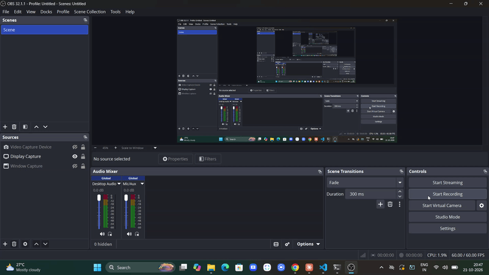

# CP Test Runner

Run your C++ solution against sample tests in one click, with a live results panel inside VS Code. Built for competitive programming and contest practice.



## Features

- Compiles the active `.cpp` file with g++ and runs it on every saved sample
- Clear verdicts per test: **PASS**, **FAIL**, **TLE** (time limit exceeded), **RE** (runtime error)
- Side-by-side expected vs actual output, with differing lines highlighted
- Add, edit, and delete samples directly in the results panel
- Compile errors shown in full, so you can fix them without leaving the editor
- Samples are stored as plain files next to your solution, so they are easy to keep in Git
- Windows line endings and trailing whitespace never cause false failures

## Requirements

- `g++` available on your PATH
  - **Windows:** install MinGW-w64 or MSYS2 and add its `bin` folder to PATH
  - **macOS:** `xcode-select --install`
  - **Linux:** install `g++` from your package manager

## Usage

1. Open a `.cpp` file.
2. Run **CP Test Runner: Run Against Samples** from the Command Palette (or press `Ctrl+Alt+R`).
3. The first time, an empty test is created. Fill in the input and expected output in the panel.
4. Press **Run**. Use **Add test** and **Delete** to manage your samples.

## How samples are stored

For `solution.cpp`, samples live in a `solution.tests/` folder beside it:

```
solution.cpp
solution.tests/
  1.in    1.out
  2.in    2.out
```

Each `.in` file is fed to your program, and its output is compared with the matching `.out` file.

## Install

**From a release:** download the `.vsix` from the [Releases](https://github.com/Mohit427/cp-test-runner/releases) page, then in VS Code open Extensions, click the `...` menu, and choose **Install from VSIX...**.

**From Open VSX:** search for "CP Test Runner" in editors that use Open VSX.

## Known limitations

- C++ only (compiled with `-O2 -std=c++17`)
- Fixed 2 second time limit per test
- Samples are entered manually, with no automatic fetching from judges

## Roadmap

- Configurable compiler flags and time limit
- Support for Python and Java
- Status bar button and test-all summary
- Import samples from the clipboard

## License

MIT